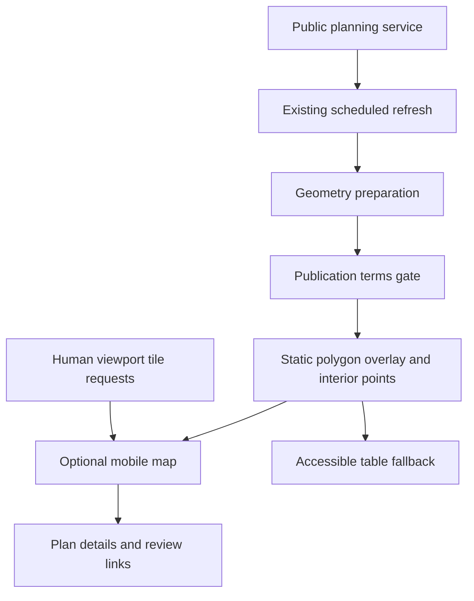

# Plan map design (issue #253)

## Status
Prototype and geometry preparation only. No public boundary export, live map
activation, workflow dispatch or new spending. The mobile preview uses synthetic
geometry and no third-party tiles. A visual review is required before any UI merge.

## Data flow

## UI
Optional panel above the plans table, initially collapsed. On opening, load local
Leaflet 1.9.4 assets and the overlay. Interior points are labelled as approximate
plan locations, not entrances. A toggle adds polygon outlines; selection opens a
popup with plain-text name/status and source/review links. Fit to council area,
not all distant polygon vertices. Mobile controls are at least 44px. The table
and in-row review links remain usable if JavaScript, geometry or tiles fail.
Missing geometry is counted, never silently placed at a guessed address.

## Sources and terms (checked 2026-10-22)
- Planning service supports Polygon and GeoJSON, with EPSG:2039 native output:
  https://ags.iplan.gov.il/arcgisiplan/rest/services/PlanningPublic/xplan_without_77_78/MapServer/1
  Live sample 101-1158146 returned a Polygon in WGS84 using outSR=4326.
- Mavat's public application uses GovMap layer sites_mh_gvul_all filtered on
  pl_number. It also links to Xplan. No embedded third-party token is reused.
  https://mavat.iplan.gov.il/
  https://ags.iplan.gov.il/xplan
- Official QGIS instructions describe connecting to public planning layers:
  https://www.gov.il/BlobFolder/generalpage/symbology_qgis/he/mavat_use_software_qgis.pdf
- Mavat's About endpoint links to the government terms. Those reserve State
  copyright including maps, permit fair use with attribution, and otherwise
  require written permission for copying/publication. A public query endpoint
  is not by itself a redistribution licence. Establish the applicable basis
  before publishing a static boundary dump; until then link to the official map.
  https://mavat.iplan.gov.il/rest/api/getAboutHtml/
  https://www.gov.il/he/general/terms_of_use
- Leaflet 1.9.4 is the current stable release and permits local hosting. Preserve
  its BSD notice when vendoring:
  https://leafletjs.com/download
  https://github.com/Leaflet/Leaflet/blob/main/LICENSE
- OSM standard tiles: only human-requested viewport tiles, visible attribution,
  browser Referer and normal HTTP caching. No bulk/prefetch/offline mode, no
  headless panning/zooming for downloads. Tests mock tiles. Best-effort only,
  no SLA; configurable tile provider, no paid fallback or billing account.
  https://operations.osmfoundation.org/policies/tiles/
  https://osmfoundation.org/wiki/Licence/Licence_and_Legal_FAQ

## Change split and tests
First PR: pure geometry preparation + design, no public data/UI activation.
Second PR: UI and refresh wiring after terms and visual approval. Geometry tests
cover WGS84 projection, holes, multipolygons, representative-point containment,
missing/invalid geometry, and a public-field allowlist. UI tests must cover
keyboard/touch activation, attribution, failed loads and safe popup text/URLs.
