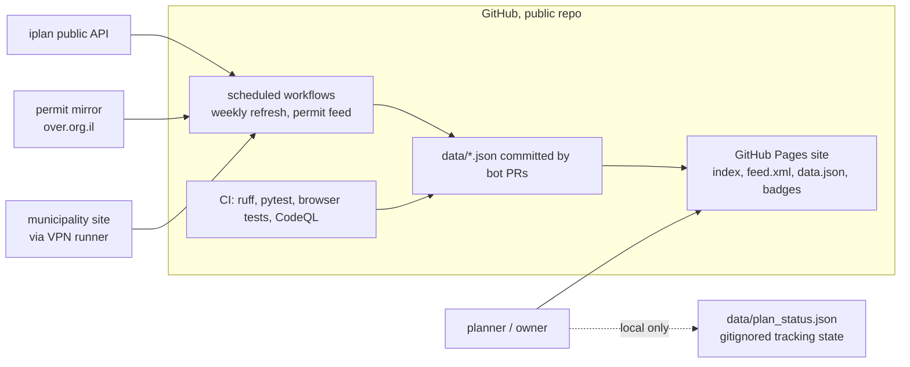
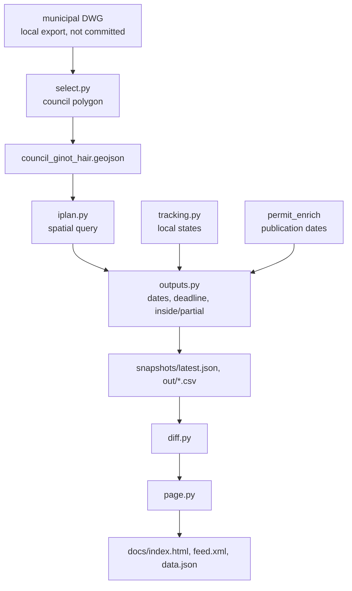
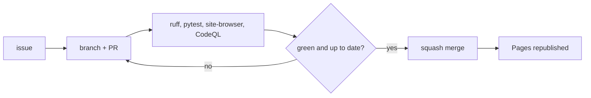

# Architecture

```
municipal DWG (EPSG:2039, user export, not committed)
   |  dwg2dxf (LibreDWG) + ezdxf          [src/ginot/dwg.py]
   v
53 unnamed council polygons
   |  landmark-driven union selection      [src/ginot/select.py]
   v
Ginot HaIr polygon -> data/council_ginot_hair.geojson (committed, WGS84)
   |  ArcGIS spatial intersect (curl)      [src/ginot/iplan.py]
   v
plan features (iplan public API, EPSG:2039)
   |  dates, inside/partial, derived objection deadline [src/ginot/outputs.py]
   |  + planner tracking states            [src/ginot/tracking.py, local only]
   v
out/*.csv|xlsx, snapshots/latest.json, out/changes.json
   |  snapshot diff                        [src/ginot/diff.py]
   v
static site: index.html (entry order), feed.xml, data.json [src/ginot/page.py]
   ^
   |  weekly Tuesday orchestration         [refresh.py + external scheduler]
```

Data flows one way: public iplan data in, derived artifacts out. The only
non-public artifact is the planner's local `data/plan_status.json`.

## Diagrams

Rule: anything that needs design gets a Mermaid diagram (in the issue or in
the docs). Generic example data only; no real plates, locations or
personal data.

### System context



### Data flow



### Change pipeline


