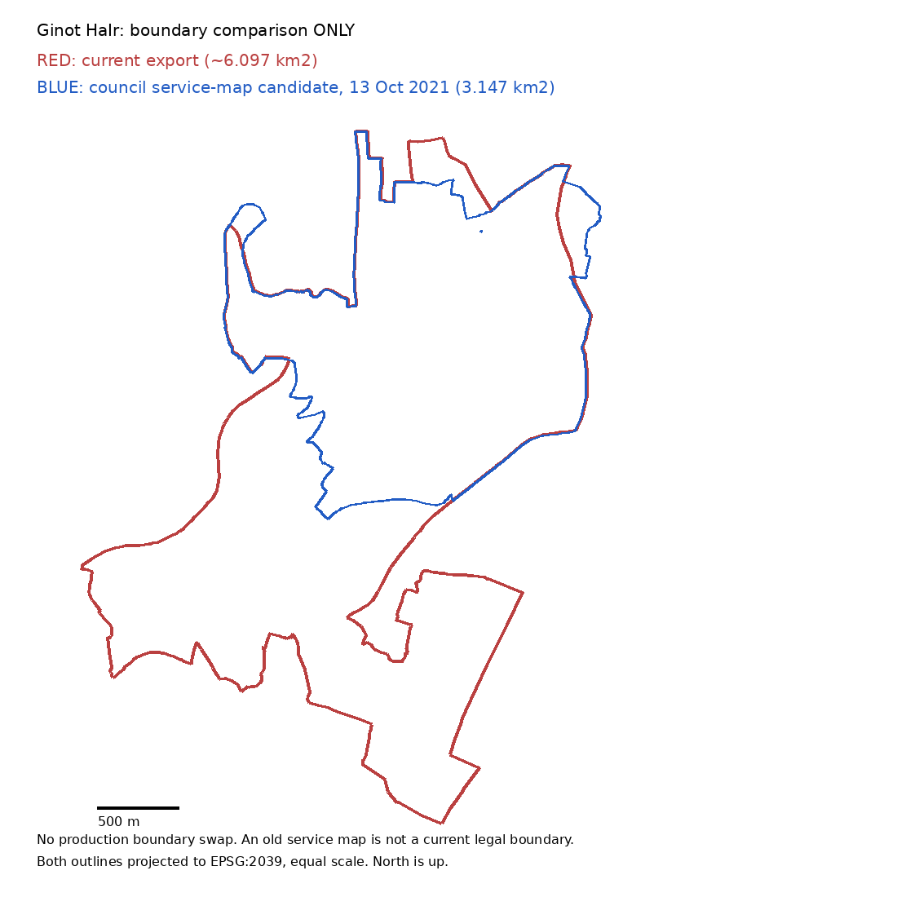

# Seven-neighborhood scope: OLD official-map comparison only

Issue #529. **Not a production boundary replacement or an adoption decision.**

## Sources and age

The council's [about page](https://www.ginothair.org.il/about-us) lists the
German Colony, Greek Colony, Rehavia, Talbiya, Old Katamon, Kiryat Shmuel and
Nayot. Checked 16 November 2026.

Its [map page](https://www.ginothair.org.il/index.php?dir=site&page=content&cs=613&langpage=heb)
links this [service-map PDF](https://www.ginothair.org.il/files/Newletter/map_of_dogs_playgrounds.pdf).
The page describes a November 2020 map; the downloaded PDF was created and
printed **13 October 2021**. It is an old service map showing facilities,
parks and blue boundaries, not a current cadastral or statutory boundary.

Its five closed blue vector paths were extracted, not traced from pixels.
Some neighborhoods are grouped; this does not independently verify seven
separate neighborhood boundaries. The candidate may have gaps or cartographic
simplifications inherited from the source. No gaps were buffered closed.

## Measured comparison, 16 November 2026

| Item | Result |
| --- | ---: |
| Existing broad council export, documented area | ~6.097 km2 |
| Old-map candidate, measured in EPSG:2039 | 3.147067 km2 |
| Current permit rows preserved | 12,556 |
| Parcel centroid inside old-map candidate | 7,294 |
| Parcel centroid outside old-map candidate | 5,262 |
| Missing geometry / edge centroid in this snapshot | 0 |

These are comparison classifications, not confirmed permit membership. A
parcel centroid is not necessarily the permit's address point. The parcel
inventory was already collected for the current broad polygon, so candidate
areas outside that inventory are not a complete survey. Address labels were
not used to manufacture geometric matches. Ramban 24 remains a separate
missing-parcel/publication problem (#857), not resolved by this comparison.



The overlay was inspected visually against the source map: the candidate
omits much of the broad export's southern extension and also differs at
several northern edges. It is not simply a strict subset of the old export.

## Reproduction and safety

The candidate is stored only in
`reference/scope/council_map_2021_candidate.geojson`, outside production data
paths. It records the source URL, source SHA-256, date, extraction method and
accuracy caveat. The source PDF is not added to the repository.

With PyMuPDF installed as an optional local research dependency, download the
exact source PDF, then:

```sh
python scripts/extract_council_scope_2021.py \
  --pdf /tmp/map_of_dogs_playgrounds.pdf --out /tmp/reproduced-scope.geojson
python scripts/compare_council_scope_2021.py --out /tmp/scope-comparison.json
```

The extractor verifies the PDF hash, fits its printed ITM grid labels, selects
exactly five closed valid blue paths, unions them, then transforms to WGS84.
Maximum fit residual is below 0.000144m, which measures reproduction of the
printed grid, **not source map accuracy**. A local rerun reproduced the
committed candidate byte for byte.

The comparison output retains every source row and appends
`in_scope_candidate_2021` (true/false/null) and a reason. It refuses to
overwrite any input file. The all-row output is generated locally rather than
duplicating the entire permit corpus in Git. No production filter, alerts,
map, existing polygon, source row or default changes in this PR.

## Decision still open

Adopt this dated map as an interim scope source, or obtain an updated boundary
layer from the council/municipality first. Adoption needs a separate reviewed
change, an explicit source/date label, a preserved all-row view, treatment of
unknowns and a production approval. This comparison does not close #529.
