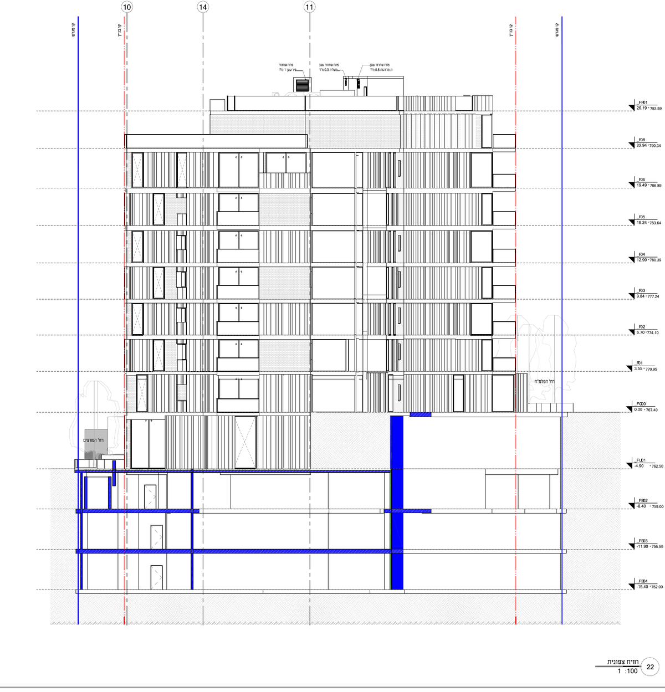
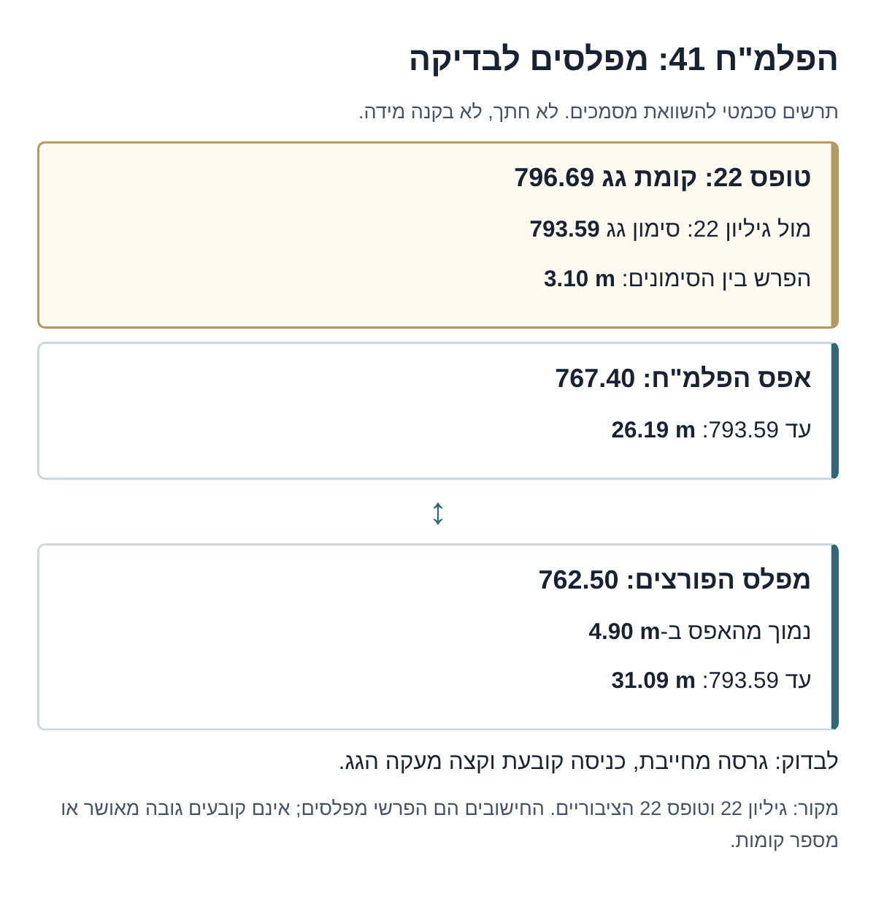
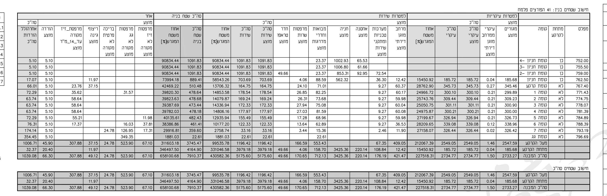
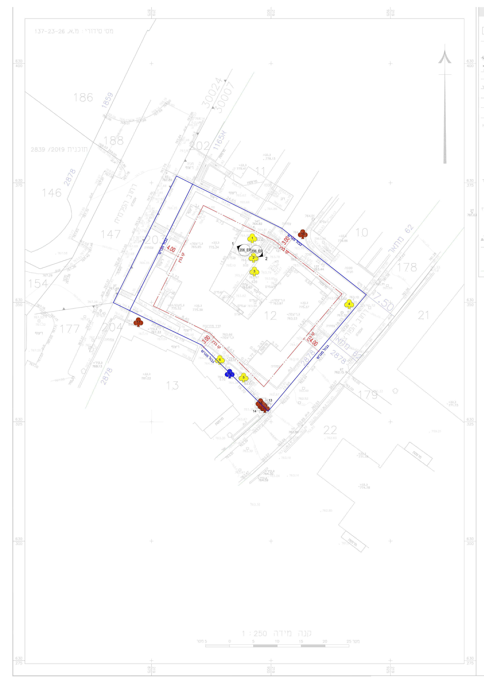
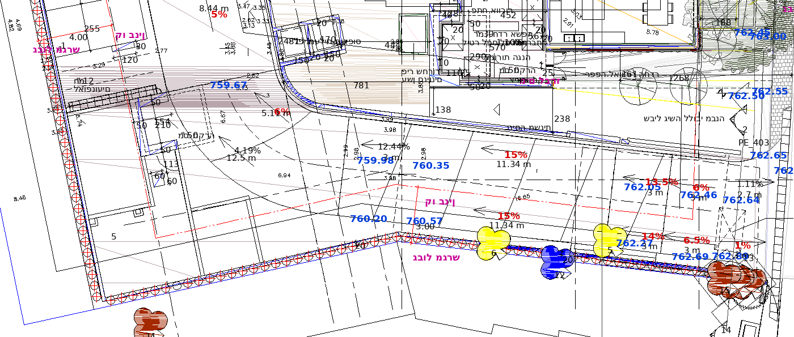
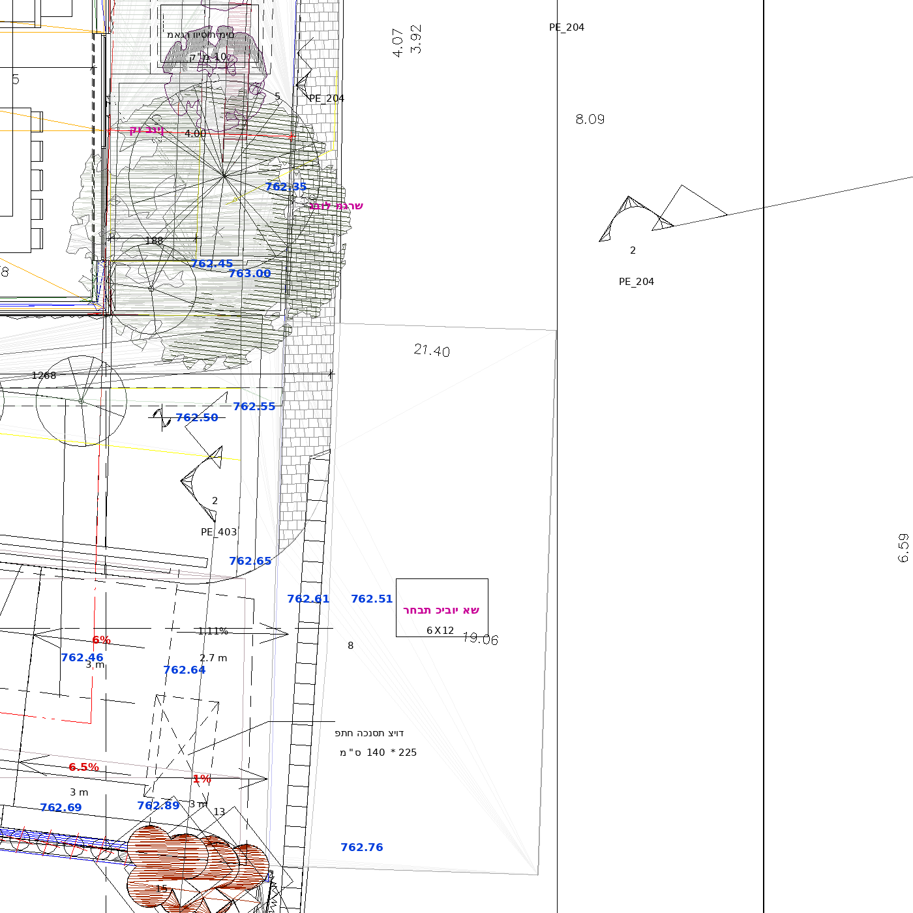
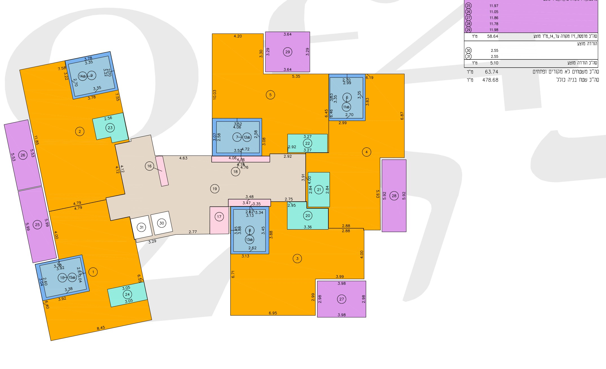
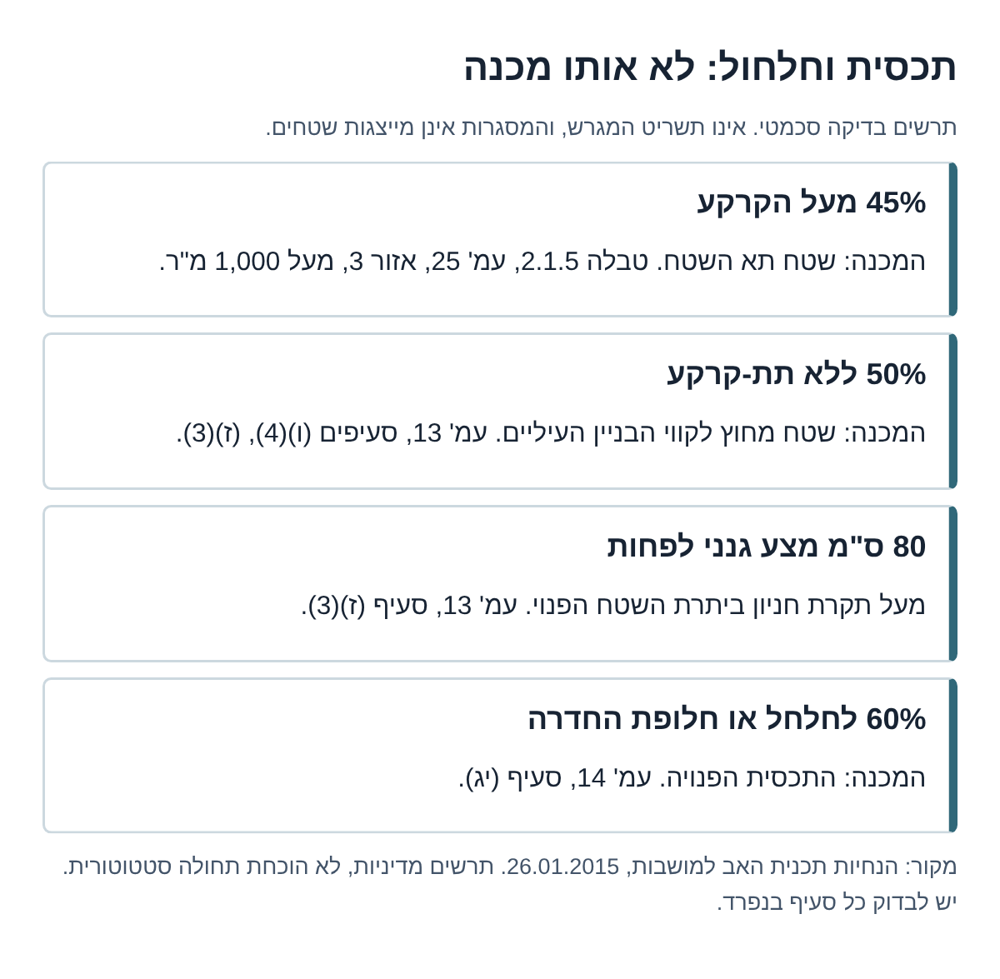

# הפלמ"ח 41: סקירה למנהלת גינות העיר
## בקשת היתר 2026/0439.00, גוש 30007 חלקה 12

טיוטת סקירת AI לעיון הציבור, עודכנה ב-04.11.2026. לא חוות דעת מקצועית או משפטית, לא כתב התנגדות ולא החלטת המנהלת. לא הוגש דבר. הסקירה משווה למדיניות תכנית האב, ואינה מחליפה בדיקת הזכויות והמסלול הסטטוטורי החלים.

## תקציר מנהלים: בדיקות בתכניות למהנדס

- **גובה וכניסה קובעת:** [גיליון 22](#drawing-levels) מול [טופס 22, טבלת הקומות](#drawing-form22): אפס 767.40, הפורצים 762.50; גג 793.59 מול 796.69. לקבוע גרסה מחייבת, מפלס כניסה וקצה מעקה; [תכנית האב עמ' 26, הערה 1](https://www.ginothair.org.il/files/wordocs/hanchayot.pdf#page=26).
- **טור זכויות:** [תכנית האב עמ' 25, טבלה 2.1.5; עמ' 26, הערה 1](https://www.ginothair.org.il/files/wordocs/hanchayot.pdf#page=25): אזור 3, מגרש מעל 1,000 מ"ר: טור א': 5 קומות, 16.5 מ', 195%; טור ב': 6 קומות, 19.5 מ', 215%. לבדוק ציר דרך-קו בניין ≥10 מ' ומרחק מבניין סמוך ≥8 מ'; בבניין פינתי הרחוב הרחב קובע. הסיווג והטור טרם אומתו חלקתית.
- **ספירת הקומה הנסוגה:** [גיליון 22 וטופס 22](#drawing-levels) מול [עמ' 14, סעיף 2.1.2(י)](https://www.ginothair.org.il/files/wordocs/hanchayot.pdf#page=14): הנסיגה בקומה העליונה המותרת בטור ב', לא קומה נוספת. ליישב 8 קומות בהודעה מול הכינוי 8.5 בלוח.
- **קווי בניין ומרתף:** [מפת המדידה הציבורית](#drawing-survey) מול [עמ' 13, סעיף (ו)(4); עמ' 14, סעיף (י)](https://www.ginothair.org.il/files/wordocs/hanchayot.pdf#page=13): שתי חזיתות הרחוב קדמיות; קו תת-קרקע קדמי כעל-קרקעי. לבדוק את קונטור החפירה בגרסה העדכנית מול הקווים, לא מול גבול החלקה בלבד.
- **תכסית וחלחול:** [עמ' 25, טבלה 2.1.5](https://www.ginothair.org.il/files/wordocs/hanchayot.pdf#page=25); [עמ' 13, סעיף (ז)(3)](https://www.ginothair.org.il/files/wordocs/hanchayot.pdf#page=13); [עמ' 14, סעיף (יג)](https://www.ginothair.org.il/files/wordocs/hanchayot.pdf#page=14): 45% על-קרקעי; 50% מהשטח מחוץ לקווים העיליים ללא תת-קרקע; 80 ס"מ מצע מעל חניון; 60% מהתכסית הפנויה לחלחל או חלופת החדרה. לחשב כל מכנה בנפרד.
- **שטחים וסיווג:** [טופס 22, שורות מעל/מתחת לקרקע](#drawing-form22): עיקרי 2,734.77 מ"ר, שירות 5,175.60 מ"ר, סה"כ 7,910.37 מ"ר; חניה תת-קרקעית 3,425.36 מ"ר. להתאים לטבלת הדרישה המתוקנת ולמקור הזכויות; הנתונים הם בגרסת הטבלה המצולמת, לא אישור זכויות.
- **רמפה ומעבר הולכי רגל:** [פרט רמפת הפורצים ופרט רחבת הכיבוי 6×12](#drawing-access) מול [עמ' 50, סעיף 5.1(ו); עמ' 51 ו-53](https://www.ginothair.org.il/files/wordocs/hanchayot.pdf#page=50): לבדוק עצים 5 ו-6, מיקום רחבה, חתך מדרכה ורוחב פנוי רציף במצב קיים/ביצוע/סופי. אין בסקירה רוחב מדרכה מדוד.
- **מאזן דירות:** [טבלת שטחים לקומה 2, מפלס 774.75](#drawing-floor2) מול [עמ' 14, סעיף (יב)](https://www.ginothair.org.il/files/wordocs/hanchayot.pdf#page=14): לבדוק סיווג עיקרי/ממ"ד ושטח הדירות; מדיניות 30% דירות חדשות עד 80 מ"ר. לקבוע תחילה את בסיס "הדירות החדשות" במיזם ההחלפה.

ההשוואה לתכנית האב היא בדיקת מדיניות, לא קביעה של סטייה סטטוטורית. גיליון 22 והתמונות הציבוריות נבדקו; קובץ ההרמוניקה המלא, אישור התכנון ואישור השימור לא נפתחו מחדש. [פערי המקור מפורטים בהמשך](#original-gaps).

**שורה תחתונה:** יש בסיס לבקש טבלת השוואה מנומקת בין הנפח המבוקש לבין מדיניות המושבות, הסבר ספירת קומות ומפלסים, ותכנית מתואמת השומרת על המדרכות, העצים והמרחב הציבורי. אין די בכינוי "8.5 קומות" או בנתון חניה כדי להוכיח חריגה חוקית או תוספת תנועה נתונה. החלטה ראויה לדיון היא דרישה מרוכזת למסמכים ולהבהרות לפני גיבוש עמדה סופית.

[חזרה לסקירות הפורום](../forum-2026-11-04.html) · [הסקירה הציבורית הקודמת ומסמכי השרטוט](review-2026-0439.00.html) · [מערכת הרישוי העירונית](https://ykpubdata.jerusalem.muni.il/#/?SystemCode=26400046)

## מה ידוע, ומה אינו מוכרע

- בהודעת הפרסום: הריסה ובנייה מחדש, 21 דירות קיימות ו-34 מוצעות, 8 קומות מעל קומות חניה ומחסנים. בלוח גינות העיר תוארו 8.5 קומות. אלה אינם בהכרח אותו בסיס ספירה; אין להסיק שהפער נובע אוטומטית מהגג או ממפלס הפורצים.
- המועד בהודעת סעיף 149 שנבדקה הוא **13.11.2026**. אין להחליפו במועד סיום פרסום מתוכנן בפיד. יש לאשר את קליטת כל מסירה בדרך ובמועד הנדרשים.
- גיליון 22 מציג מפלס 0.00=767.40 ברחוב הפלמ"ח ומפלס 4.90-=762.50 בצד הפורצים. הגובה המסומן בגג הוא 793.59. זהו בסיס לבקשת חתך ספירה מוסבר, לא הצדקה להמרת 4.90 מטר ל"קומה וחצי".
- השוואת המדיניות היא לאזור מגורים 3 ולמגרש מעל 1,000 מ"ר, כפי שסווג בסקירה הקודמת. **יש לקבל אישור חלקתי לסיווג ולשיוך לטור א' או ב'.** תכנית האב אינה כשלעצמה היתר למספר קומות מסוים; מעמדה המחייב והיחס לתכנית 10038 ולתכניות החלות דורשים בירור.

## שרטוט: מאיזה רחוב נמדד הגובה?

<figure><figcaption>ההרמוניקה הציבורית, מסמך 24, גיליון 22, מסומן "חזית צפונית". חיתוך ללא שינוי בקווים. 767.40 פחות 762.50 הם 4.90 מ'; 793.59 פחות 767.40 הם 26.19 מ'; ביחס ל-762.50 ההפרש הוא 31.09 מ'. אלה חישובי הפרשי מפלסים בלבד. יש לאמת אם נקודת 793.59 היא קצה מעקה הגג הקובע למדיניות או רכיב אחר. אין למדוד מרחקים מהתמונה המוקטנת.</figcaption></figure>

**לבקש:** חתך לכל אחת משתי חזיתות הרחוב ובו פני הקרקע הקיימים והמתוכננים, הכניסה הקובעת, קומות מגורים/שירות/חניה, גג ומעקות, מתקנים טכניים והבסיס לספירה. יש להסביר כל הבדל בין טופס 22, גיליון 22 והודעת הפרסום, לפי גרסה ותאריך. עצם ההפרש אינו הוכחה שהוגשה בקשה מטעה.

## שרטוטים נוספים לבדיקת התיק

לחיצה פותחת מקור גדול. החיתוכים אינם תכנית מאושרת; אין למדוד מהתצוגה המוקטנת. התרשימים המסומנים סכמטיים מציגים קשרי בדיקה בלבד.

<figure><figcaption>תרשים סכמטי, לא חתך ולא בקנה מידה. הפרשי מפלסים מחושבים משני המקורות הציבוריים; אינם מכריעים מהו גובה הבניין הקובע.</figcaption></figure>

<figure><figcaption>טופס 22, "חישוב שטחים בנין: 41 הפורצים פלמח", מתוך ההרמוניקה הציבורית בסקירה הקודמת. שורות מפלסים ועמודות עיקרי/שירות/חניה. מספר הגיליון והתאריך אינם מופיעים בחיתוך הציבורי ולכן לא הושלמו. יש להתאים לגרסה המלאה והעדכנית. מקור: <a href="photos/form22.jpg">התמונה הציבורית</a>.</figcaption></figure>

<figure><figcaption>מפת מדידה בקנ"מ מקור 1:250, פרויקט הפורצים-הפלמ"ח 41. כחול: גבול מגרש; אדום: קו בניין, לפי התוויות במקור. מוצגים עצים ומידות קווי בניין. אין כאן סימון חדש של הקונטור המבוקש, גבול חפירה או הרחבה מותרת; מספר גיליון לא זוהה בתמונה הציבורית. מקור: <a href="photos/survey.jpg">מפת המדידה הציבורית</a>.</figcaption></figure>

<figure><figcaption>חיתוך תכנית רמפה ציבורית; נראים עצים 5 ו-6 ומקטעי שיפוע. השיפועים מסומנים במקור ואינם מדידה עצמאית. אין כאן אישור שהרמפה הוסטה או שהתנאים מולאו. מקור: <a href="photos/ramp-closeup.png">החיתוך הציבורי</a>; מספר גיליון לא זוהה בחיתוך.</figcaption></figure>

<figure><figcaption>חיתוך תכנית ציבורית עם סימון "רחבת כיבוי אש 6X12", מדרכה ורמפה. 6×12 היא המידה הכתובה של הרחבה, לא רוחב המדרכה. יש לבדוק מיקום מאושר וחתך מעבר פנוי. מקור: <a href="photos/apron-closeup.png">החיתוך הציבורי</a>; מספר גיליון לא זוהה בחיתוך.</figcaption></figure>

<figure><figcaption>חיתוך תרשים חישוב שטחים: קומה 2, מפלס 774.75, לפי כותרת וטבלת המקור. צבעים וסימוני שטח מקוריים, ללא תוספת קווים; אין להסיק מצבע לבדו מהו שטח דירה חוקי. מקור: <a href="photos/floor-plates.jpg">הגיליון הציבורי עם הכותרת</a>, <a href="photos/area-table.jpg">טבלת קומה 2</a>. מספר גיליון לא זוהה בתמונה הציבורית.</figcaption></figure>

<figure><figcaption>תרשים סכמטי של ארבע בדיקות מדיניות מתכנית האב: 45%, 50%, מצע 80 ס"מ ו-60% או חלופת החדרה. אינו מפת כיסוי, לא קובע מהי התכסית המבוקשת ולא מוכיח תחולה סטטוטורית.</figcaption></figure>

## ההשוואה לתכנית האב: מדיניות מול הבקשה

המקור: [הנחיות תכנית האב למושבות, 26.01.2015](https://www.ginothair.org.il/files/wordocs/hanchayot.pdf). כל מספר עמוד להלן הוא העמוד המודפס, הזהה למספרו בקובץ שנקרא. [עמ' 7-8](https://www.ginothair.org.il/files/wordocs/hanchayot.pdf#page=7) מתארים מדיניות מוטת שימור ובחינה מול התיעוד המתחמי וסקר האתר. "פער מדיניות" אינו שקול אוטומטית לסטייה מתכנית סטטוטורית.

### 1. קומות, גובה ואחוזי בנייה

**המדיניות:** [עמ' 25, טבלה 2.1.5](https://www.ginothair.org.il/files/wordocs/hanchayot.pdf#page=25), אזור מגורים 3, מגרש 1,001 מ"ר ומעלה: טור א' 5 קומות, 16.5 מ', 195%; טור ב' 6 קומות, 19.5 מ', 215%; תכסית 45%. אחוזים אלה הם מסגרת המדיניות, לא חישוב הזכויות המותרות בבקשה זו.

**פער לבדיקה:** מול נתון 8 קומות בהודעה קיים פער חשבוני של 2-3 קומות משתי חלופות המדיניות. התאמה בבסיס הספירה עדיין לא הוכחה, ולכן אין להציג זאת כחריגה משפטית מוכחת. סימון גג 793.59 ביחס לאפס 767.40 נותן 26.19 מ', אך אין עדיין בסיס לקביעת חריגה בגובה בלי זיהוי קצה המעקה, הכניסה הקובעת והמסגרת החלה.

**מה לדרוש:** טבלה אחת ובה המקור הסטטוטורי לכל קומה ולכל סוג שטח, עמודת השוואה לתכנית האב, והנמקה תכנונית לכל פער. יש להפריד בין סמכות לתת זכויות במסלול הרישוי לבין השאלה מדוע נכון לממשן בנפח המבוקש באתר זה.

### 2. טור א' או טור ב': לא בחירה לפי התוצאה הרצויה

[עמ' 26, הערה 1](https://www.ginothair.org.il/files/wordocs/hanchayot.pdf#page=26): טור ב' תלוי במרחק של לפחות 10 מ' מציר אמצע זכות הדרך לקו הבניין הקדמי. בבניין פינתי קובע הרחוב הרחב יותר. מרחק קטן מ-8 מ' מבניין סמוך קיים מפנה לטור א'. [עמ' 27](https://www.ginothair.org.il/files/wordocs/hanchayot.pdf#page=27) כולל הוראה נפרדת לאורך פארק המסילה; אין להסיק ממנה שטור ב' חל רק שם.

**מה לדרוש:** מפת מדידה עם ציר זכות הדרך, קו הבניין הקדמי, רוחבי שתי הדרכים ומרחקי המבנים הסמוכים, והחלטה כתובה מה הטור החל ומדוע. עד אז אין בסיס לבחור אוטומטית ב-6 קומות ו-19.5 מ' כזכאות ודאית, או ב-5 קומות כגבול מוכרע.

### 3. נסיגה אינה "חצי קומה" שאינה נספרת

[עמ' 14, סעיף 2.1.2(י)](https://www.ginothair.org.il/files/wordocs/hanchayot.pdf#page=14): נסיגות בחזית הקדמית מותרות בקומה העליונה **המותרת על פי טור ב'**, ולא כתוספת עליה. בטור א' אין נסיגות בחזית הקדמית לפי סעיף זה. בבניין פינתי שתי החזיתות לרחובות נחשבות קווי בניין קדמיים.

**מה לדרוש:** לסמן את הקומה הנסוגה, שטחה ומספרה בתוך הספירה המאושרת; להסביר את מקור הכינוי 8.5, אם נעשה בו שימוש בבקשה. גג טכני, נסיגה וחדר יציאה לגג אינם זהים, ואין לפטור רכיב מספירה בלי מקור מתאים.

### 4. כניסה קובעת ומפלסים: שני כללים נפרדים

[עמ' 26](https://www.ginothair.org.il/files/wordocs/hanchayot.pdf#page=26) מודד גובה מבנה בעל גג שטוח מהכניסה הקובעת 0.00 עד קצה מעקה הגג. [עמ' 12, סעיף 2.1.2(ה)](https://www.ginothair.org.il/files/wordocs/hanchayot.pdf#page=12) מגביל שינוי של מפלס כניסה קובעת, עם חריג למגרשים ריקים לצורך חניה תת-קרקעית ובתנאים הרשומים שם.

באותו עמ' 12, סעיף קטן (ג)(3) דן **בבניינים קיימים** שקומת המגורים הראשונה שלהם 2.50 מ' ויותר מעל הרחוב: החלק התחתון נכלל במניין, עם אפשרות פטור של מהנדס העיר לקיר תומך או חניה. אין להחיל את הכלל אוטומטית על בניין חדש או להפוך את 4.90 המטר לשיטת ספירה חדשה.

**מה לדרוש:** אישור בחירת הכניסה הקובעת ותחולת כללי הספירה על הריסה ובנייה מחדש, בצירוף מפלסים מקוריים ומתוכננים. צריך להציג את השפעת המבנה על שתי חזיתות הרחוב גם אם מדידת הגובה הפורמלית נעשית מאפס אחד.

### 5. תכסית, מרתפים, חלחול ומצע גנני

[עמ' 13, סעיפים (ו)(4), (ז)(3)](https://www.ginothair.org.il/files/wordocs/hanchayot.pdf#page=13) מבדיל בין קו בניין תת-קרקעי קדמי, שהוא כעל-קרקעי, לבין קווים אחוריים/צדיים שיכולים להגיע ל-0 בתנאי שלפחות 50% מהשטח שמחוץ לקווי הבניין העיליים יישאר בלי בנייה תת-קרקעית. יתרת השטח הפנוי שמעל חניון צריכה מצע גנני בעובי 80 ס"מ לפחות. [עמ' 14, סעיף (יג)](https://www.ginothair.org.il/files/wordocs/hanchayot.pdf#page=14) מוסיף שלפחות 60% מהתכסית הפנויה יהיו ללא תת-קרקע ויאפשרו חלחול, או שתוכח חלופת החדרת נגר.

**אין לאחד מכנים שונים:** 45% תכסית מעל הקרקע, אחוז כיסוי תת-קרקעי של כלל המגרש, 50% מהשטח שמחוץ לקווי הבניין, ו-60% מהתכסית הפנויה אינם אותו נתון. חלופת חלחול בסעיף אחד אינה הוכחה לפטור מכל יתר כללי המדיניות.

**מה לדרוש:** תרשים שטחים צבעוני עם מכנה לכל חישוב, קווי שתי החזיתות הקדמיות, גבול חפירה, חלחול/חלופה, עובי מצע ובתי גידול לעצים. גם דרישה עירונית לצמצם מרתף אינה כשלעצמה הוכחה שהתכנית תוקנה בהתאם.

### 6. עצים, רמפה ומדרכות

[עמ' 50, סעיף 5.1(ו)](https://www.ginothair.org.il/files/wordocs/hanchayot.pdf#page=50) דורש תכנית תנועה ועיצוב לפיתוח רחובות ומדרכות, בתיאום תושי"ה ואדריכל העיר. [עמ' 51, סעיף 5.2](https://www.ginothair.org.il/files/wordocs/hanchayot.pdf#page=51) עוסק בסקר עצים, שורשים, ליווי אגרונומי וגינות גג; [עמ' 53, סעיף (ח)](https://www.ginothair.org.il/files/wordocs/hanchayot.pdf#page=53) קובע שחניה ושינוי קווי בניין יתחשבו בעצים וברצועה הירוקה.

**מה לדרוש:** חתך רחוב מאושר למצב קיים, לביצוע ולמצב הסופי; רוחב מעבר הולכי רגל פנוי ורציף בכל קטע; שיפועים ונגישות; מיקום כניסת חניון, רחבת כיבוי, עצים ותשתיות; ופתרון שתואם בין כל הגורמים. רצוי לבקש חלופות בתוך המגרש לפני קבלת פגיעה במרחב הציבורי. אין בסקירה מדידת רוחב מדרכה עצמאית או הוכחה שכל הגורמים כבר אישרו את הפתרון.

### 7. תמהיל דירות ומימוש זכויות

[עמ' 14, סעיף (יב)](https://www.ginothair.org.il/files/wordocs/hanchayot.pdf#page=14) קובע ש-30% מכלל הדירות החדשות יהיו עד 80 מ"ר. יש לברר מהן "הדירות החדשות" במיזם החלפה זה ואיך מחושב שטחן; לא להחיל אוטומטית את האחוז על כל 34 היחידות או רק על 13 התוספתיות בלי הבהרה. [עמ' 13, סעיף (ט)(1)](https://www.ginothair.org.il/files/wordocs/hanchayot.pdf#page=13) קובע שבסתירה בין נפח הבנייה לבין זכויות מרביות גוברות ההנחיות המגבילות יותר.

**מה לדרוש:** טבלת תמהיל ושטחים, הסבר תחולה וחשבון מלא שאינו מסתפק באחוז הבנייה הכולל. אלה בדיקות מדיניות, לא מסקנה שכבר הופרה חובה סטטוטורית.

## דרישות העירייה: מה מדווח בסקירה הקודמת ומה לא אומת מחדש

[הסקירה הציבורית הקודמת](review-2026-0439.00.html) מדווחת שמחלקת התכנון דרשה תיקון סיווג שטחי שירות ואחוזי הבנייה; דחתה רחבת כיבוי המוצעת על המדרכה; ודרשה צמצום תכסית תת-הקרקע מ-100% ל-80%. היא מדווחת גם על הסטת רמפה לטובת עצים 5 ו-6 ועל רצועת גינון של 1.5 מ' כלפי שני הרחובות.

**אלה דיווחים ממקור משני בסקירה זו.** מסמכי העירייה המקוריים לא נפתחו מחדש בבדיקה הנוכחית, ולכן אין כאן אישור חדש לנוסח התנאים, למספרי העמודים, לשיוכם למסמך מסוים או למילויים בגרסה הסופית. עמודי תכנית האב המפורטים לעיל כן נקראו; אין לערבב אותם עם עמודי דרישות העירייה שטרם אומתו. אפשר לבקש טבלת מענה לתנאים, אך יש לצרף את המקור לפני שמצטטים תנאי כטענה עובדתית בהליך.

**שלושת המקורות שיסגרו את הפער:** לפי רשימת הארכיון הציבורית שנשמרה בתיק, כולם נקלטו ב-24.09.2026. מספרי 11/12/24 הם מספרי פריטים ברשימה זו, לא עמודים ולא מספרי גיליונות.

- **מסמך 11, "אישור מחלקת התכנון"**: [המקור העירוני](https://jerarchivews.jerusalem.muni.il/api/items/16E57A23-0D2B-464C-ACAD-30895F07B87D). נדרש לאימות דרישות שטחים, אחוזים, רחבת כיבוי ותכסית, ותאריך/גרסת הבדיקה.
- **מסמך 12, "מחלקת שימור-אישורי גורמים"**: [המקור העירוני](https://jerarchivews.jerusalem.muni.il/api/items/1B904968-6923-4446-9CFD-23FD04F1E91C). נדרש לבדיקת דרישות שימור, עצים, מצע גנני ורצועות גינון. אין כאן קביעה שכל התנאים המדווחים אכן מופיעים במסמך זה.
- **מסמך 24, "הרמוניקה בפורמט PDF"**: [המקור העירוני](https://jerarchivews.jerusalem.muni.il/api/items/5D3BD126-6D0F-42D0-80A8-F3D6B714DB2A). נדרש לבדיקת הגרסה המלאה, טופס 22, טבלאות השטחים, תכנית הפיתוח והחתכים. החיתוך הציבורי של גיליון 22 נבדק, אך אינו תחליף לקובץ המלא והעדכני.

כל שלושת הקישורים החזירו חסימת 403 בבדיקה הנוכחית. חסימת גישה אינה הוכחה שהמסמכים אינם קיימים או אינם זמינים לציבור בערוץ אחר. גם קבלת שלושתם לא תחליף בירור אם הוגשו מאז מסמכים מתוקנים או התקבלה החלטה חדשה.

## מנהל תקין: בקשות ממוקדות לפני עמדה סופית

1. **תיק עדכני ועקבי:** רשימת מסמכים וגרסאות; טבלת התאמה בין הודעת הפרסום, טופס 22, גיליונות הבנייה ודרישות הגורמים. אם יש שינוי מהותי, לבקש החלטה מנומקת האם דרוש פרסום נוסף. אין לקבוע מראש שכל תיקון מחייב פרסום מחדש.
2. **תשובות לתנאים:** לכל דרישת מחלקת התכנון והשימור, לציין היכן תוקנה הבקשה, מי בדק ומתי. מסמך תנאים אינו אישור שהכול מולא, ואינו הוכחה שהבקשה הסופית מפרה אותם.
3. **טבלת שטחים בת בדיקה:** עיקרי, שירות, חניה ותת-קרקע בנפרד, והמקור לסיווג. יחס גדול של שטחי שירות אינו כשלעצמו הוכחה לשימוש אסור; נדרשת בדיקה של סוג השטח ומיקומו.
4. **מסגרת ההליך:** לזהות את ההוראות והתאריכים המאפשרים דיון בבקשה במסלול הנתון, לרבות הוראות מעבר ככל שחלות. מועד העלאה או פתיחת תיק לבדו אינו מוכיח עמידה או אי-עמידה בתנאי המסלול.
5. **תנועה בלי קיצורי דרך:** להציג חישוב יצירה ופיזור נסיעות, שעות שיא ומפגש רכב-הולך רגל. 42 מקומות חניה אינם בהכרח 42 רכבים חדשים או מספר קבוע של נסיעות לשעה. בהיעדר ספירות אין לקבוע תוספת תנועה מדודה.
6. **החלטה מנומקת ושוויון ענייני:** לבקש תשובה לכל נושא מהותי והשוואה למקרים בעלי מאפיינים ותכניות דומים. כתובת קרובה או מספר קומות דומה אינם לבד הוכחה לאפליה או תקדים מחייב.

הסקירה עוסקת בנושאים להתנגדות אפשרית לבקשת היתר. **ערר על החלטה הוא שלב אחר:** יש לזהות החלטה, מסלול, זכות ומועד לפני המלצה עליו. בקשת מסמכים או הבהרות אינה עוצרת כשלעצמה את מועד ההתנגדות. [הנחיות מינהל התכנון על סמכויות ועדת הערר](https://www.gov.il/BlobFolder/policy/instructions_planning/he/District_planning_institutions_Powers_planning.pdf) מבחינות בין התנגדות לפי סעיף 149 וערר על החלטה לפי סעיף 152, ומדגישות שזכות הערר והזמנים תלויים במקרה ובדין. לא נבדקה כאן החלטה שמתחילה מניין לערר.

## החלטה אחת מוצעת לדיון במנהלת

לקדם בדיקה מרוכזת מול הוועדה לקבלת תיק עדכני וטבלת תשובות לנושאים לעיל, תוך שמירת מועדי ההליך, ולהחזיר למנהלת עמדה מנומקת לאחר השלמת המידע. זהו כיוון לדיון, **לא נוסח מאושר למשלוח**, לא אישור להגיש התנגדות ולא קביעה שהבקשה בלתי חוקית.

## מקורות ומגבלות

- [תכנית האב: דף המסמכים של גינות העיר](https://www.ginothair.org.il/index.php?cs=595&dir=site&langpage=heb&page=content), [הנחיות 26.01.2015](https://www.ginothair.org.il/files/wordocs/hanchayot.pdf). העמודים המפורטים נקראו. המעמד הסטטוטורי המחייב לא אומת.
- [הרמוניקה ציבורית, מסמך 24 בארכיון העירוני](https://jerarchivews.jerusalem.muni.il/api/items/5D3BD126-6D0F-42D0-80A8-F3D6B714DB2A), גיליון 22. הקישור המקורי חסום ב-403 בבדיקה הנוכחית; החיתוך הציבורי נבדק חזותית בנפרד.
- [לוח גינות העיר](https://padlet.com/urbaniginot/padlet-z2ggkr2fhi4u38bv): מקור משני לכינוי 8.5 קומות, לא לשיטת ספירה מאומתת.
- טרם אומתו כאן מדידה חלקתית, בסיס טור א'/ב', תכנית בינוי סופית, החלטה המסיימת את ההליך או חשבון זכויות מלא. אין בסקירה ייחוס עמדה לאדם פרטי.
